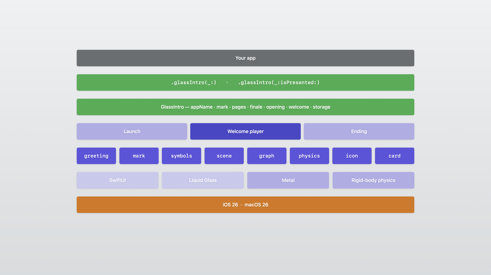
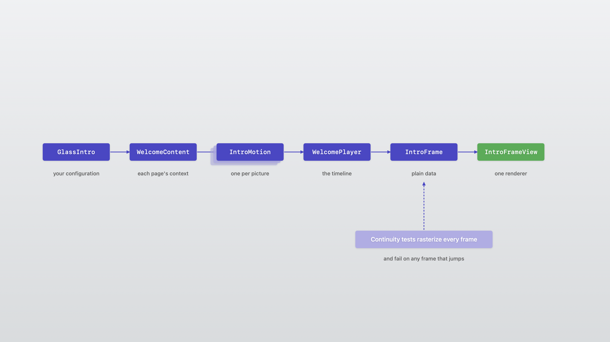

# Architecture

How GlassIntroKit is built, for contributors.



## Every picture is data

Each picture is an `IntroMotion`: given a time, it returns an `IntroFrame` — plain data describing glass outlines, symbols, the scene, the mark, and a card. It draws nothing itself.



| Type | Role | Where |
|---|---|---|
| `GlassIntro`, `GlassIntroPage` | The public configuration | `Sources/GlassIntroKit/API` |
| `WelcomeContent` | Each page's context: canvas, symbols, traced outlines | `Welcome/Model` |
| `IntroMotion` | One per picture: the frame at any time, and what it hands on | `Welcome/Motions/<Picture>` |
| `WelcomePlayer` | The timeline: carries a picture straight on, or through the drop of glass | `Welcome/Model` |
| `IntroFrame` | Plain data for one frame | `Welcome/Rendering` |
| `IntroFrameView` | The one renderer: Liquid Glass and the Metal scene | `Welcome/Rendering` |
| `LaunchSequenceView` | The launch, the welcome's host, and the hand-over to the app | `Launch` |

## How pictures join

When a page turns, the player asks the next picture whether it can carry on from what the current one hands on (an `IntroHandoff`). If it can, the next picture starts from it. Otherwise the current picture gathers into the seed, a drop of glass the size of the mark's body, and the next grows out of it. Before the last page, the picture lets go where it is.

## Tests

The tests rasterize `IntroFrame`s into small grey images and fail on any frame that jumps: every page after every other page, random welcomes, every graph shape, every scene, any number of falling nodes, phone and window sizes, and resized windows. Run them in release:

```sh
swift test -c release -Xswiftc -enable-testing
```

## Adding a picture

1. Add a folder under `Welcome/Motions` with a type that conforms to `PageMotion`.
2. Add a case to `GlassIntroPage.Visual` and to `IntroPicture`, and a factory on `GlassIntroPage`.
3. Decide what it hands on and what it can carry on from.
4. Add tests: its frames, and continuity to and from every other picture.

## Diagrams

The diagrams are drawn with SwiftUI. To redraw them into the DocC catalog:

```sh
swift run --package-path Documentation/Tools/Diagrams
```

## Screenshots and video

The screenshots and the video are recordings of the demo app, put in Apple's device frames by `Tools/Framing`. [Making the Preview Video](PreviewVideo.md) walks through it.

See also [SwiftUI and Metal](SwiftUIAndMetal.md) for which part draws what.
