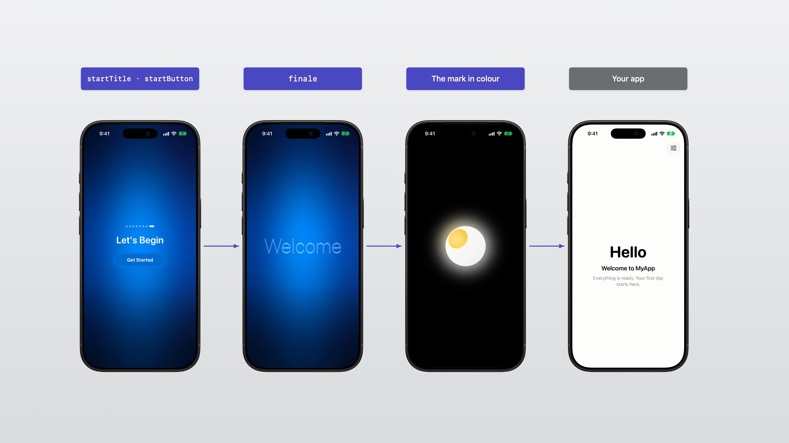

# The Ending and the Mark



## The words

The last page asks to begin. Its button plays the ending: up to three lines of glass words, then the mark fills with colour and dissolves over your app.

```swift
GlassIntro(appName: "Orbit", pages: pages)                                // "Welcome", "to", "Orbit"
GlassIntro(appName: "Orbit", pages: pages, finale: ["Have a", "good trip"])
GlassIntro(appName: "Orbit", pages: pages, finale: [])                    // straight to the mark
```

The buttons and the last page's title are yours to word too:

```swift
GlassIntro(
    appName: "Orbit",
    pages: pages,
    startTitle: Text("Off You Go"),        // "Let's Begin"
    startButton: Text("Start Exploring"),  // "Get Started"
    continueButton: Text("Next")           // "Continue", on every other page
)
```

## The mark

| Mark | What it is |
|---|---|
| `.standard` (default) | A white pearl with a yellow light set into it, high on its left. |
| `.symbol(_:color:)` | An SF Symbol on a white body. |
| `.custom(outline:view:)` | Artwork of your own. |

In glass, the mark's detail is cut out of its body. A custom mark gives its view and its outline for glass — the body with the detail cut out, opening from the plain body at 0 to the full detail at 1:

```swift
.custom(outline: { rect, opening in myMarkOutline(in: rect, opening: opening) }) {
    MyMarkView()
}

// The outline is drawn off the main actor, from `rect` and `opening` alone.
nonisolated func myMarkOutline(in rect: CGRect, opening: CGFloat) -> Path {
    // The body, with the detail cut out of it, scaled by `opening`.
}
```

To show the mark in your own views, use `GlassIntroMarkView(mark)`.
