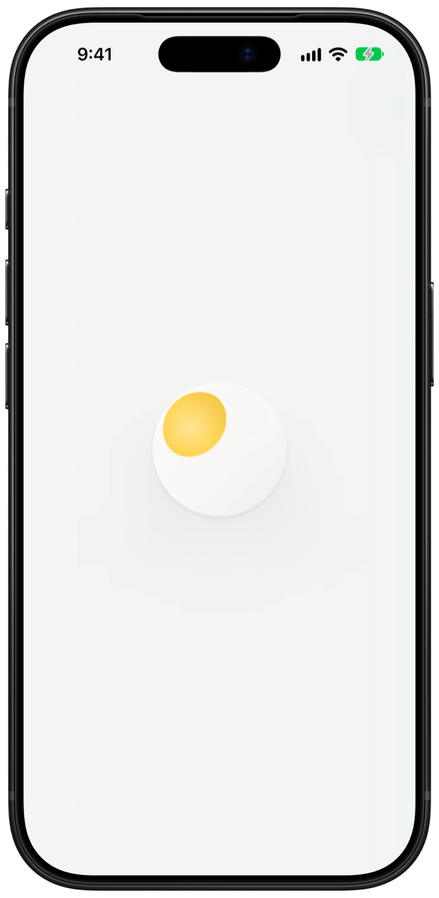
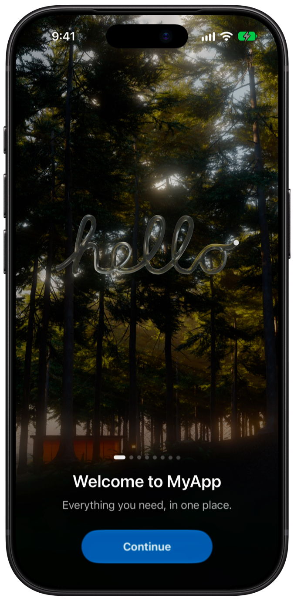
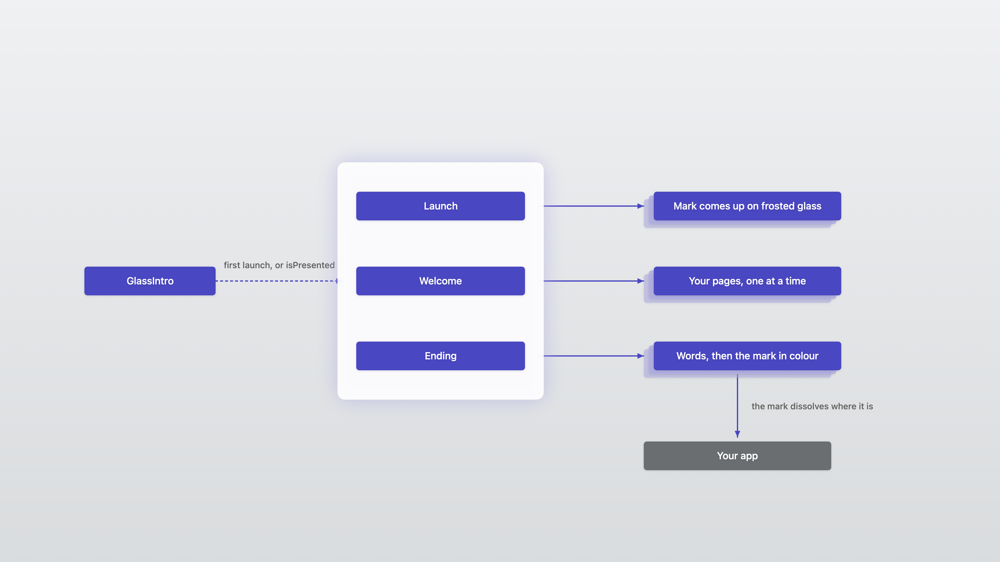
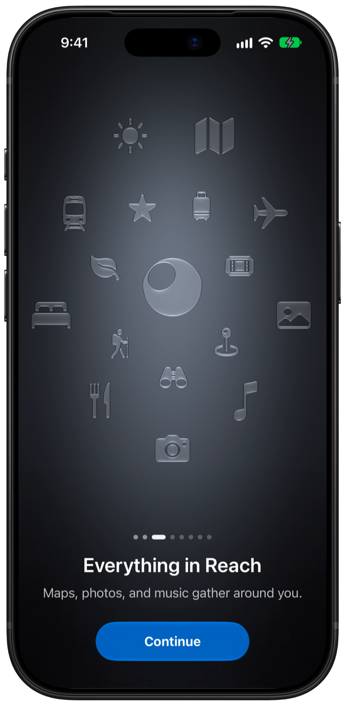
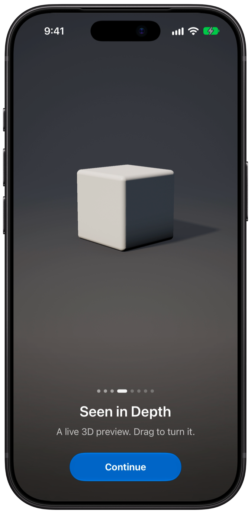
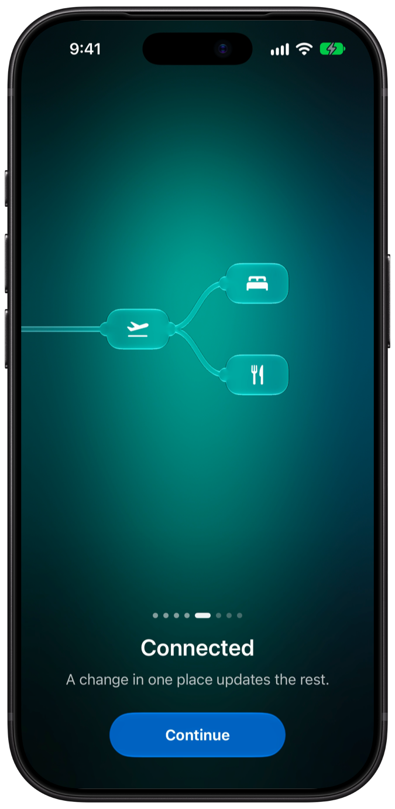
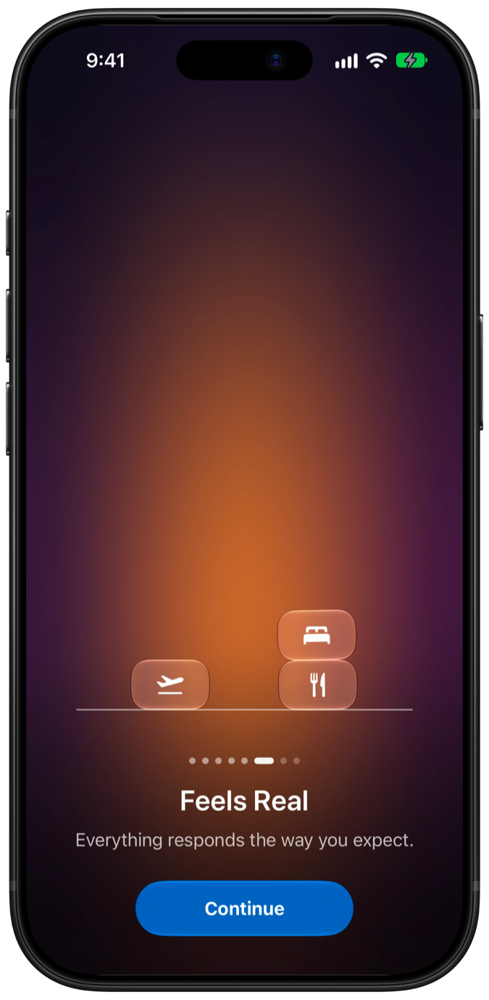
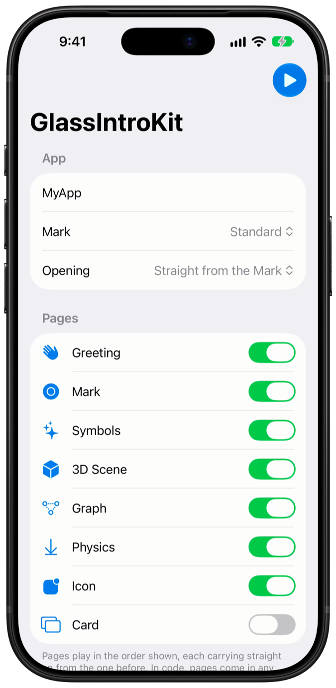

# Getting Started

Add GlassIntroKit to an app and build an intro step by step.

| | |
|---|---|
| Platforms | iOS 26+, macOS 26+ |
| Swift | 6.3+ (tested with Xcode 27 and Swift 6.4) |
| Built-in text | English |

## 1. Add the package

In Xcode, choose **File › Add Package Dependencies…** and enter `https://github.com/Jiaxu-Li/GlassIntroKit.git`. In a package:

```swift
dependencies: [
    .package(url: "https://github.com/Jiaxu-Li/GlassIntroKit.git", from: "0.2.0"),
],
targets: [
    .target(name: "MyApp", dependencies: ["GlassIntroKit"]),
]
```

## 2. Add an intro

Give your window's root view the `glassIntro` modifier, with your app's name and a first page:

```swift
import GlassIntroKit
import SwiftUI

@main
struct OrbitApp: App {
    var body: some Scene {
        WindowGroup {
            ContentView()
                .glassIntro(
                    appName: "Orbit",
                    pages: [
                        .greeting("Welcome to Orbit", message: "Plan trips with the people you travel with."),
                    ]
                )
        }
    }
}
```

Run the app. The launch opens on the mark, and the welcome plays its page:

<p>
  
  
</p>

The launch plays once per process, in the first window that shows it. The welcome plays on the first launch; to see it again while you work, set `welcome: .everyLaunch` (see [Playing the Intro](Playing.md)).



## 3. Tell your story

Add pages in any order. Each picture carries on from the one before or meets it in a drop of glass:

```swift
pages: [
    .greeting("Welcome to Orbit", message: "Plan trips with the people you travel with."),
    .mark("Simple, by Design", message: "One calm place for every plan."),
    .symbols("Everything in Reach", message: "Maps, photos, and notes gather around each trip."),
    .scene("Seen in Depth", message: "A live 3D preview. Drag to turn it."),
    .graph("Connected", message: "A change in one plan updates the rest."),
    .physics("Feels Real", message: "Everything responds the way you expect."),
    .icon("Ready When You Are", message: "Packed and ready to go."),
]
```

<p>
  
  
  
  
</p>

Every page can be configured. See [Pages](Pages.md).

## 4. Choose the ending

After the last page's **Get Started**, the words of `finale` turn in, then the mark fills with colour and dissolves over your app:

```swift
.glassIntro(appName: "Orbit", pages: pages, finale: ["Have a", "good trip"])   // or [] for none
```

See [The Ending and the Mark](Ending.md).

## 5. Play it again

Use a binding to play the intro whenever people ask:

```swift
struct ContentView: View {
    @State private var showsIntro = false

    var body: some View {
        Button("Show the Intro") { showsIntro = true }
            .glassIntro(GlassIntro(appName: "Orbit", pages: pages), isPresented: $showsIntro)
    }
}
```

## The demo app

Open `Examples/GlassIntroDemo/GlassIntroDemo.xcodeproj` and run it on iOS or macOS. It opens on a settings screen where you can try every option, writes out the code for what you set up, and **Play** plays it.


