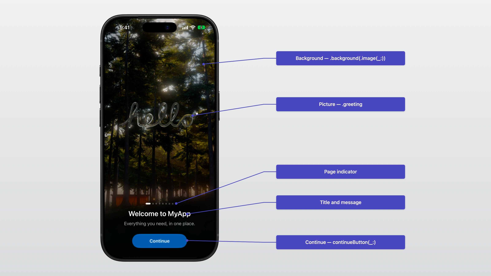
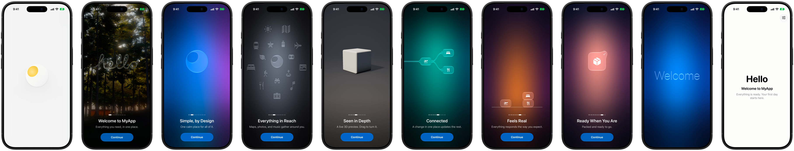
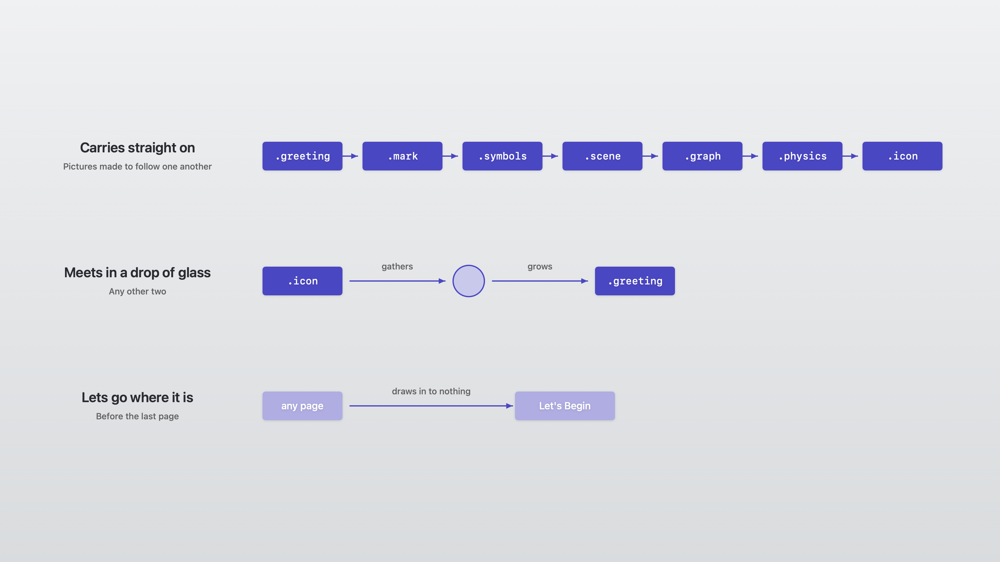

# Pages

The welcome tells your app's story with eight pictures, in any order, each with a title, a message, and a button.



## The pictures

| Page | Picture | Options |
|---|---|---|
| `.greeting` | The mark gathers into a pen and writes "hello" in glass. | |
| `.mark` | The mark in glass, its detail opening. | |
| `.symbols` | The mark melts into a symbol, and glass symbols scatter out of it. | `symbols:`, `center:` |
| `.scene` | A glass lens opens over a live Metal scene. | `scene:`, or a view of your own |
| `.graph` | A wire shoots out of a glass point, and a graph grows. | `nodes:`, or `graph:` |
| `.physics` | Up to eight nodes fall onto a line. | `nodes:` |
| `.icon` | Glass gathers into an app icon, polished and badged. | `symbol:`, `badge:` |
| `.card` | Your own SwiftUI view on a card of glass. | a view builder |



## How pages connect

Pictures made to follow one another — greeting, mark, symbols, scene, graph, physics, icon — carry straight on. Any other two meet in a drop of glass. Before the last page, the picture lets go where it is.



## Graphs

Any nodes, wired any way. Nodes are laid out in columns and scaled to fit the window:

```swift
.graph("Connected", message: "…", nodes: ["calendar", "person.2.fill", "creditcard.fill"])  // the first branches to the rest
.graph("Pipeline", message: "…", graph: .chain(["tray.fill", "gearshape.fill", "paperplane.fill"]))
.graph("Trip", message: "…", graph: .diamond("airplane.departure", through: ["bed.double.fill", "fork.knife"], into: "airplane.arrival"))
.graph("Yours", message: "…", graph: GlassIntroGraph(
    nodes: ["envelope.fill", "calendar", "checklist", "bell.fill"],
    links: [.init(0, 2), .init(1, 2), .init(2, 3)]
))
```

Links run from an earlier node to a later one; any other link is left out. A `.physics` page right after a graph drops the graph's own nodes.

## Scenes

```swift
.scene("Seen in Depth", message: "…", scene: GlassIntroScene(
    shape: .ring,            // .cube, .sphere, .ring, .capsule, .cylinder
    color: .orange,
    motion: .float,          // .turntable, .turntable(speed:), .tumble, .float, .still
    revealsRendering: false, // open fully lit
    isDraggable: true
))

// Or a view of your own, such as a RealityView, through the same lens.
.scene("Your World", message: "…") {
    MyRealityView()
}
```

## Cards, backgrounds, and buttons

```swift
.card("Your Itinerary", message: "Any view can be a page.") {
    ItineraryCard()
}
.background(.color(.indigo))          // .automatic, .color(_:), or .image(_:)
.continueButton(Text("Almost There"))
```

## SF Symbols

Symbols are traced into glass outlines. Some SF Symbols may only refer to particular Apple products and must not be modified; the SF Symbols app marks them. Don't pass those to a page. The default symbols may be used by anyone.
